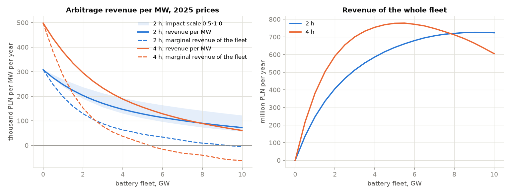
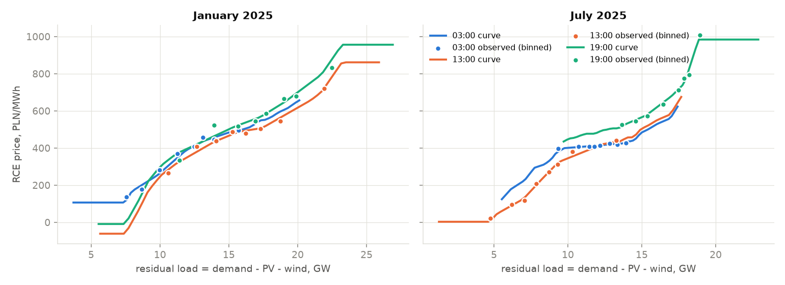
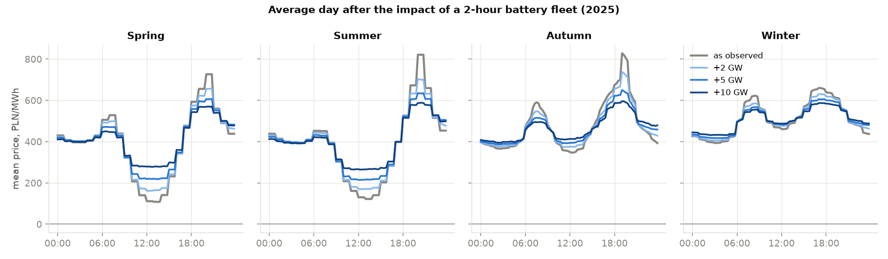
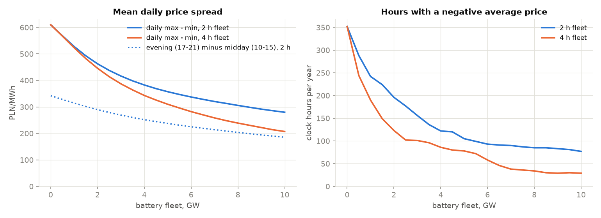

# pl-bess-saturation


**Dashboard: https://kwwaleszczynski-del.github.io/pl-bess-saturation/**

Batteries are arriving in Poland by the gigawatt, and they all earn from the same thing: the gap between cheap
midday or night hours and the expensive evening. Every battery that charges at noon and discharges at 19:00 narrows
that gap for all the others. This project measures how fast. It fits an empirical supply curve (day-ahead price
against residual load) on public data of the transmission system operator PSE, then lets a fleet of 0-10 GW of
batteries trade the 2025 prices while moving them along that curve. It is the storage counterpart of solar price
cannibalisation ([pl-capture-price](https://github.com/kwwaleszczynski-del/pl-capture-price)): an illustration of
the mechanism, not a price forecast.



**In short (2025 prices, 2-hour batteries):** the first MW earns 308 k PLN per year from day-ahead arbitrage. With
2 GW of new batteries in the system each MW earns 203 k PLN (-34%), with 5 GW 128 k PLN (-58%) and with 10 GW 72 k
PLN (-76%). The next MW added to a 5 GW fleet still earns 128 k PLN itself, but it raises the revenue of the whole
fleet by only 45 k PLN, because it also takes spread away from the batteries already there. A 4-hour fleet saturates
faster: its total revenue stops growing at about 5.5 GW.

## The problem

A price-taking backtest such as [bess-arbitrage-pl](https://github.com/kwwaleszczynski-del/bess-arbitrage-pl) answers
"what would one battery have earned at the prices we saw?". It is the right answer for the first MW and the wrong one
for the tenth GW: prices were set without those batteries. When storage charges, the rest of the system must
produce more and the price at that hour rises; when it discharges, more expensive plants are pushed out and the
evening price falls. The more storage, the flatter the daily price curve and the lower the revenue per MW. For anyone
valuing a battery project in a market where several GW are in the pipeline, the relevant question is what is left
for the next GW.

## Method

**Data.** Prices and fundamentals come from the public PSE reports API (details in
[Data source](#data-source-and-terms-of-use)): the RCE price (`rce-pln`) and national demand, PV and wind
generation (`his-wlk-cal`), every 15 minutes since 14 June 2024. The residual load of interval $`t`$ is

```math
L_t = D_t - G^{\mathrm{PV}}_t - G^{\mathrm{W}}_t
```

with demand $`D_t`$ and PV and wind output $`G_t`$. Existing pumped-storage plants (up to 1.4 GW of pumping in
2025-2026) are part of the observed system; the simulated fleet comes on top of them.

**Supply curve.** For every month $`m`$ and local clock hour $`h`$ a monotone, piecewise-linear curve
$`f_{m,h}`$ is fitted to the prices of that month and hour: quantile bins of $`L_t`$ (at most 10, at least 24
quarter-hours each), the mean price per bin, pool-adjacent-violators to make the bin means non-decreasing and linear
interpolation between bin centres. Outside the load range seen in that hour, the curve continues along the curve of
the whole month (30 bins), shifted to join, and beyond that it is flat. The curve is used only through differences,
so the part of the price it does not explain (fuel prices, imports, outages, the day of the week) is kept:

```math
p'_t(x) = p_t + s \left[ f_{m,h}(L_t + x) - f_{m,h}(L_t) \right]
```

where $`p_t`$ is the observed price, $`x`$ the net charging of the fleet (MW, positive while charging) and $`s`$ an
impact scale.

**Validation.** Five curve types were compared out of sample, in two tests. *Blocked cross-validation*: ISO weeks
are split into five folds and each fold is predicted by curves fitted without it. *Year ahead*: each month is
predicted by the curves of the same month one year earlier (15 months). The level of the price is the easy part;
what the fleet needs is the slope, so the main score compares the price change between the same quarter-hour on two
consecutive days with the change the curve predicts. The hour-of-day pattern cancels in that difference, and what
is left is mostly the effect of wind, sun and demand on the residual load. The *response ratio* is the OLS slope of
actual on predicted changes for pairs whose residual load differs by at least 2 GW, the size of move a GW-scale
fleet makes (1 means the curve gets the response right on average, below 1 means it overstates it).

| Supply curve | Test | R² price level | R² day-to-day change | MAE day-to-day, PLN/MWh | Response ratio |
|---|---|---:|---:|---:|---:|
| linear, per month | blocked CV | 0.70 | 0.39 | 101 | 0.77 |
| monotone, per month | blocked CV | 0.73 | 0.44 | 93 | 0.79 |
| monotone, per month x 4 hours | blocked CV | 0.76 | 0.45 | 91 | 0.82 |
| **monotone, per month x hour (used)** | **blocked CV** | **0.77** | **0.46** | **89** | **0.84** |
| monotone, per month x hour | year ahead | 0.61 | 0.42 | 93 | 0.88 |
| monotone, load net of imports, per month x hour | blocked CV | 0.74 | 0.37 | 94 | 0.87 |

The curve per month and hour is best on every score of the blocked test. Load net of imports (demand minus PV, wind
and the cross-border balance) explains day-to-day changes worse, because imports themselves react to the price; the
residual load lets them react as they did historically. Even the best curve overstates the price response: actual
changes are 84% of the predicted ones. **The fleet therefore uses $`s = 0.84`$**, calibrated by this test; the
uncalibrated curve ($`s = 1`$) and a much flatter response ($`s = 0.5`$) are shown as a sensitivity. The response
ratio is higher in winter (about 0.9) than in spring (about 0.74); one scale is used for the whole year.



**Fleet in competitive equilibrium.** The fleet is $`N`$ MW of identical batteries with the parameters of
bess-arbitrage-pl: duration 2 or 4 hours, round-trip efficiency 87% ($`\eta = \sqrt{0.87}`$ each way), usable state
of charge 5-95%, the same state of charge (50%) at the start and end of each day, at most 1.5 full cycles per day and
a degradation cost $`c^{\mathrm{deg}}`$ of 30 PLN per MWh discharged. The batteries belong to many owners, each too
small to move the price. In the competitive equilibrium every owner maximises revenue at the prices $`p'`$ that the
fleet as a whole creates; because $`p'`$ rises with $`x`$, that equilibrium is the solution of one convex problem
per delivery day:

```math
\min_{c,\,d} \; \sum_t \Delta t \int_0^{x_t} p'_t(u)\, \mathrm{d}u \; + \; c^{\mathrm{deg}} \sum_t \Delta t \, d_t ,
\qquad x_t = c_t - d_t
```

subject to

```math
e_t = e_{t-1} + \eta \, \Delta t \, c_t - \frac{\Delta t}{\eta} d_t , \qquad
0.05\,E \le e_t \le 0.95\,E , \qquad e_T = e_0 = 0.5\,E ,
```

```math
0 \le c_t, d_t \le N , \qquad \Delta t \sum_t d_t \le 1.5 \cdot 0.9\,E ,
```

with charging $`c_t`$, discharging $`d_t`$, stored energy $`e_t`$, energy capacity $`E = N \cdot`$ duration and
$`\Delta t`$ = 0.25 h. The integral is piecewise quadratic and convex; it is represented exactly at 40 breakpoints per
interval (segment variables filled in merit order), so each day is a linear program (HiGHS via SciPy). Where the LP
charges and discharges in the same interval (burning energy through losses at deeply negative prices), the day is
solved again as a MILP with a binary mode per interval. At $`N = 0`$ a 1 MW battery trades the observed prices; this
reproduces the daily revenues of bess-arbitrage-pl for 2025 to within $`10^{-11}`$ PLN.

**Revenue and marginal revenue.** Each battery earns $`\sum_t p'_t(x_t)\,(d_t - c_t)\,\Delta t`$ minus the
degradation cost; $`r(N)`$ is that revenue per MW and year. The revenue of the whole fleet is $`R(N) = N\,r(N)`$,
and its derivative

```math
R'(N) = r(N) + N \, r'(N)
```

is the marginal revenue: what one more MW adds to the fleet. It is lower than $`r(N)`$ by the spread the new MW takes
from the incumbents. It is computed by central differences on a 0.5 GW grid ($`R'(0) = r(0)`$).

## Results

Base year 2025 (365 days), RCE prices, impact scale 0.84. All tables are in [`results/`](results/).

**2-hour batteries**

| Fleet | Revenue per MW, k PLN/yr | vs first MW | Marginal revenue, k PLN/MW/yr | Fleet revenue, m PLN/yr | Cycles/day | Daily spread, PLN/MWh | Evening 17-21, PLN/MWh | Midday 10-15, PLN/MWh | Hours with negative price |
|---|---:|---:|---:|---:|---:|---:|---:|---:|---:|
| 0 (as observed) | 308 | | 308 | 0 | 1.36 | 610 | 630 | 288 | 352 |
| 1 GW | 247 | -20% | 198 | 247 | 1.29 | 528 | 614 | 299 | 242 |
| 2 GW | 203 | -34% | 129 | 406 | 1.23 | 463 | 599 | 310 | 196 |
| 5 GW | 128 | -58% | 45 | 640 | 1.05 | 357 | 573 | 335 | 105 |
| 10 GW | 72 | -76% | -5 | 724 | 0.84 | 280 | 551 | 365 | 77 |

**4-hour batteries**

| Fleet | Revenue per MW, k PLN/yr | vs first MW | Marginal revenue, k PLN/MW/yr | Fleet revenue, m PLN/yr | Cycles/day | Daily spread, PLN/MWh | Evening 17-21, PLN/MWh | Midday 10-15, PLN/MWh | Hours with negative price |
|---|---:|---:|---:|---:|---:|---:|---:|---:|---:|
| 0 (as observed) | 498 | | 498 | 0 | 1.24 | 610 | 630 | 288 | 352 |
| 1 GW | 381 | -23% | 285 | 381 | 1.13 | 523 | 605 | 309 | 190 |
| 2 GW | 296 | -41% | 152 | 591 | 1.03 | 446 | 586 | 327 | 123 |
| 5 GW | 155 | -69% | 9 | 777 | 0.81 | 310 | 553 | 364 | 78 |
| 10 GW | 61 | -88% | -61 | 605 | 0.60 | 207 | 525 | 397 | 29 |

**Revenue per MW falls fast at first.** The first GW of 2-hour batteries takes 20% off the revenue of every MW, the
second another 18%. The cut is deepest in winter, when the curve is steep at high loads and spreads are small:
2 GW halve the revenue of January and December 2025 (to 52% and 48% of the price-taker value) but leave 74% in
June. **The marginal revenue falls faster still**: at 2 GW the next MW of a 2-hour fleet earns 203 k PLN itself
but adds only 129 k PLN to the fleet, at 5 GW 45 k PLN. The fleet's total revenue peaks at about 726 m PLN per
year at 9 GW (2 hours) and at 778 m PLN at 5.5 GW (4 hours); beyond that, more batteries reduce what the fleet
earns in total. In a competitive market they would still be built as long as $`r(N)`$ covers their
cost, which is why the per-MW line, not the fleet line, is the investor's number, and why the gap between the two
is the cannibalisation.

**Duration.** Per MW, 4-hour batteries earn more at every fleet size up to 7.5 GW (at 10 GW: 61 vs 72 k PLN).
Per MWh of capacity they earn less from the start (124 vs 154 k PLN/MWh at 0 GW), and a fleet of the same energy
earns about the same per MWh: 4 GW x 4 h earns 47 k PLN/MWh, 8 GW x 2 h 45 k PLN/MWh. What saturates the market is
the stored energy, not the power.



**Flattening.** The fleet lifts the cheapest hours and shaves the most expensive ones. With 2 GW of 2-hour
batteries the mean daily spread (maximum minus minimum) falls from 610 to 463 PLN/MWh, the mean daily maximum from
815 to 715 PLN/MWh and the evening mean (17:00-21:00) from 630 to 599 PLN/MWh, while the midday mean rises from 288 to
310 PLN/MWh. The average (baseload) price hardly moves (442 to 440 PLN/MWh): storage moves energy between hours, it
does not make it cheaper on average.

**Negative prices.** Charging goes first to the cheapest hours, so the hours with a negative average price fall
fastest: from 352 in 2025 to 196 with 2 GW of 2-hour batteries and 123 with 2 GW of 4-hour batteries. They do not
disappear: on long sunny weekends the negative stretch lasts longer than a 2-hour fleet can absorb (77 hours remain
at 10 GW, 29 with 4-hour batteries).



**Comparison with the price-taker backtest.** bess-arbitrage-pl, with the same battery parameters and the same
prices, finds 308 k PLN per MW in 2025 for 2 hours and 498 k PLN for 4 hours. That is exactly the 0 GW row here.
The price-taker number is the revenue of the first MW; at 2 GW of new storage it overstates the 2025 revenue per MW
by half (308 vs 203 k PLN, 2 hours) to two thirds (498 vs 296 k PLN, 4 hours).

**Sensitivity to the price response** (2-hour batteries, revenue per MW in k PLN per year):

| Impact scale | 0 GW | 1 GW | 2 GW | 5 GW | 10 GW |
|---|---:|---:|---:|---:|---:|
| 1.0 (curve as fitted) | 308 | 239 | 190 | 111 | 57 |
| **0.84 (calibrated, used)** | **308** | **247** | **203** | **128** | **72** |
| 0.5 (much flatter) | 308 | 269 | 237 | 177 | 122 |

A response half as steep as the fitted curve, for example because neighbouring markets absorb more of the fleet's
charging and discharging than they did in 2024-2026, would leave 177 instead of 128 k PLN per MW at 5 GW. The
direction and the shape of the result do not depend on the scale; its size does.

## Context: how much storage is coming

Quoted from public sources, read on 22 October 2026, **not computed here and to be verified** before reuse. A
capacity-market obligation is the installed power times a derating factor, which for storage was cut from auction
to auction, so obligations and installed power differ a lot. Trade-press estimates are marked as secondary.

| Item | Value (to be verified) | Source |
|---|---|---|
| Pumped storage already in the system | about 1.46 GW at the end of 2023 (Żarnowiec 711 MW, Porąbka-Żar 540 MW, Solina 199 MW and three small plants); part of the observed prices | [URE, storage report 2024](https://www.ure.gov.pl/download/9/14751/Raportmagazynyenergii.pdf) |
| Capacity market, all storage contracts (main auctions 2021-2028, additional 2021-2025) | 9.5 GW: 7.1 GW existing and 0.5 GW modernised pumped storage, 1.9 GW new batteries | [URE, storage report 2024](https://www.ure.gov.pl/download/9/14751/Raportmagazynyenergii.pdf) |
| Main auction for 2028 (December 2023) | 33 battery units, 1,734 MW of contracts, about 25% of all obligations (7,071 MW) | [URE, storage report 2024](https://www.ure.gov.pl/download/9/14751/Raportmagazynyenergii.pdf) |
| Main auction for 2029 (December 2024) | batteries about 2.5 GW of obligations, about 4.2 GW installed, derating factor 61.3%; clearing price 264.90 PLN/kW/year | [ESS News, 18 Dec 2024](https://www.ess-news.com/2024/12/18/polish-capacity-market-auction-for-2029-catalyzes-gigawatts-of-battery-storage-projects/) (secondary); price: URE final results |
| Main auction for 2030 (December 2025) | clearing price 465.02 PLN/kW/year, 6,888 MW of obligations in total; batteries about 0.7 GW of obligations, about 5 GW installed (estimate), derating factor 13.39% | [URE, Informacja nr 1/2026](https://www.ure.gov.pl/download/9/15928/InformacjaPrezesaUrzeduRegulacjiEnergetykiNr12026.pdf); batteries: ESS News, 30 Dec 2025 (secondary) |
| Storage with capacity contracts, according to PSE | about 0.17 GW in 2027, 2 GW in 2028, 4 GW in 2029, up to 5 GW in 2030 | [Parkiet, 10 Jul 2026](https://www.parkiet.com/energetyka/art44802621-magazyny-pomoga-ale-nie-rozwiaza-problemu) (secondary) |
| First large batteries | 200 MW / 800 MWh in Ełk energised in June 2026; PSE expected about 1 GW of storage during 2026 | [gramwzielone.pl, 19 Jun 2026](https://www.gramwzielone.pl/?p=20363672) (secondary) |
| Grid connection conditions for storage | about 60 GW issued (PSE, September 2025); 112 GW of declared battery plans for the next decade (PSE, July 2026); conditions without the advance payment due on 30 October 2026 lapse | [gramwzielone.pl, 30 Sep 2025](https://www.gramwzielone.pl/?p=20334453) (secondary) |
| PSE transmission development plan 2027-2036 (draft, June 2026) | 18.2 GW of storage in 2036 and 24 GW in 2040, next to 43.3 GW of PV in 2036 | [PSE presentation](https://www.gov.pl/attachment/82762589-c07f-4d57-a40c-7d64ba39c51e) |
| National energy and climate plan (KPEiK 2024, WAM) | about 2.7 GW of batteries in 2030 and about 8.5 GW in 2040, as cited by the Minister of Energy | [answer to parliamentary question 11057, 26 Aug 2025](https://api.sejm.gov.pl/sejm/term10/interpellations/attachment/ATTDKYHHM/i11057-o2.pdf) |

Read against these numbers, the 0-10 GW range of this project is not hypothetical: the batteries already holding
capacity contracts for 2028-2030 are several GW of installed power, PSE plans the grid for 18 GW of storage in 2036,
and the connection queue is an order of magnitude larger. On the 2025 price shape, 5 GW of 2-hour batteries would
take 58% off the day-ahead arbitrage revenue of each MW (4-hour: 69%). The same years will also bring much more PV,
which widens spreads and adds negative hours, and that is not in this model: the results say how quickly storage
eats the spread, not how large the spread will be.

## Limitations

- **No model of the European market.** Poland is coupled with its neighbours (SDAC). Imports and exports react to
  the fleet only as much as they reacted to load changes in 2024-2026, through the fitted curve. Batteries and
  solar built abroad, new interconnectors and flow-based capacity are not modelled; a larger coupled market would
  spread the fleet's effect and flatten the response (see the sensitivity).
- **Nothing else reacts.** PV, wind, demand, the conventional fleet and the existing pumped storage stay as observed
  in 2025, and so do their bids. In reality curtailment at negative prices, flexible demand, new PV, plant
  retirements and gas and CO2 prices change the curve, and a market with much more storage would also have a
  different generation mix.
- **The curve is empirical.** It describes how prices co-moved with residual load in each month and hour of 2024-2026
  and is extrapolated along the whole-month curve, then flat, beyond the observed range. The validation shows that it
  overstates the response by about 16% on average (corrected by the impact scale) and that the error differs by
  season. Interactions between hours (start-up costs, ramping, hydro and pumped storage shifting their own energy)
  are not represented.
- **Arbitrage only, perfect foresight per day.** The fleet trades day-ahead energy with known prices, independently
  each day. Balancing, reserves (FCR, aFRR), the capacity market, intraday trading, grid fees and taxes are not
  included; for real batteries they are a large part of revenue, and storage entering reserve markets saturates
  those too.
- **One kind of battery, one kind of owner.** The fleet is an aggregate of identical batteries in a competitive
  market. A mix of durations, technical limits of individual sites, grid constraints and strategic bidding by large
  portfolios (which would hold back to keep spreads) are not modelled.
- **One base year.** 2025 is the last full year in the data. Revenues of 2026 differ (bess-arbitrage-pl finds higher
  price-taker revenue in 2026); run `--year 2026` for the year to date.

Market rules change (for example the move of the day-ahead market to 15-minute products on 1 October 2025, the
definition of RCE or the rules of the capacity market) and should be checked against current sources before reusing
these results. This is an illustration of a mechanism, not a price forecast, and nothing here is investment advice.

## Data source and terms of use

All data are public reports of **PSE S.A.** (Polskie Sieci Elektroenergetyczne, the Polish transmission system
operator), downloaded from the reports API `https://api.raporty.pse.pl/api` without a key:

| Report | Fields used | Meaning |
|---|---|---|
| `rce-pln` | `rce_pln` | RCE, market price of electricity (day-ahead), PLN/MWh |
| `his-wlk-cal` ("Wielkości podstawowe") | `demand` | demand of the national power system, MW |
| | `pv`, `wi` | total generation of PV and wind sources (units on and off the balancing market), MW |
| | `swm_p`, `swm_np` | balance of parallel and non-parallel cross-border exchange (+ = import), MW; validation only |
| | `jgm` | net output of storage units (pumped storage pumping), MW; descriptive only |
| | `jg`, `jnwrb` | generation of units active / not active on the balancing market, MW; cached, not used |

`dtime_utc` is the **end** of each 15-minute interval; the code converts it to the interval start. Requests use
`$filter` on `business_date`, `$first=20000` and follow `nextLink`. The data are cached as monthly Parquet files
in `data/` (about 5 MB), which is not part of the repository. The RCE price was hourly until 30 September 2025 (the
four quarter-hours of an hour share one price) and has 15-minute resolution from 1 October 2025.

**Terms of use.** PSE publishes conditions for re-using public sector information
([www.pse.pl, BIP, "Ponowne wykorzystywanie informacji sektora publicznego"](https://www.pse.pl/bip/ponowne-wykorzystanie-informacji-publicznej),
entry changed on 14 October 2026, checked on 22 October 2026). They allow commercial and non-commercial re-use of
information published on www.pse.pl free of charge, on condition that the user names the source and the date the
information was obtained, removes the PSE logo, and, when the information has been processed, tells recipients that
it was changed and how, without misleading them. PSE accepts no liability for processed information and notes that
some materials may be protected by copyright or database rights. These conditions are written for www.pse.pl; this
project applies them to the reports API of the same operator. Attribution as required:

> Information obtained from www.pse.pl (PSE S.A. reports `rce-pln` and `his-wlk-cal`), state as of 22 October 2026.
> The information has been processed in whole or in part: combined across reports, used to fit supply curves and to
> simulate a battery fleet, and aggregated to annual, seasonal and monthly statistics. It is not an official PSE
> publication.

The repository contains no raw PSE data, only derived statistics in `results/` and `docs/`.

## Usage

```bash
python -m venv .venv
.venv/Scripts/python -m pip install -e ".[dev]"      # Linux/macOS: .venv/bin/python

python -m bess_saturation fetch                       # download the PSE series into data/ (~5 MB, ~1 min)
python -m bess_saturation run                         # validation, fleet sweep, results/, figures, dashboard
python -m bess_saturation run --offline --today 2026-10-22 --workers 8   # rebuild from the cache
python -m bess_saturation run --year 2026 --results results_2026        # another base year
python -m bess_saturation render                      # figures and dashboard from results/ only
pytest -q                                             # synthetic data, no network
```

A full run (validation, 42 fleet simulations of 365 days and 22 sensitivity runs, about 23,000 daily LPs) takes about
8 minutes on a laptop with 8 worker processes.

```
src/bess_saturation/
  pse_api.py     PSE API client with monthly Parquet cache
  supply.py      monotone supply curves per month and hour, out-of-sample validation
  fleet.py       competitive-equilibrium dispatch of a price-making fleet (LP, MILP fallback)
  analysis.py    fleet-size sweep, marginal revenue, price statistics and daily profiles
  context.py     quoted public figures on the Polish storage fleet
  figures.py     README figures (matplotlib)
  dashboard.py   static HTML page (Plotly.js), light and dark theme
  cli.py         fetch | run | render
```

**GitHub Pages.** `docs/` holds the dashboard (`docs/index.html`, built from `results/`); Pages can serve it directly
(Settings > Pages > Deploy from a branch, `main`, `/docs`). The results are a scenario analysis of a fixed base year,
so there is no scheduled rebuild.

## License

Code: MIT, see [LICENSE](LICENSE). Data: PSE S.A. public reports, see [Data source and terms of use](#data-source-and-terms-of-use).
